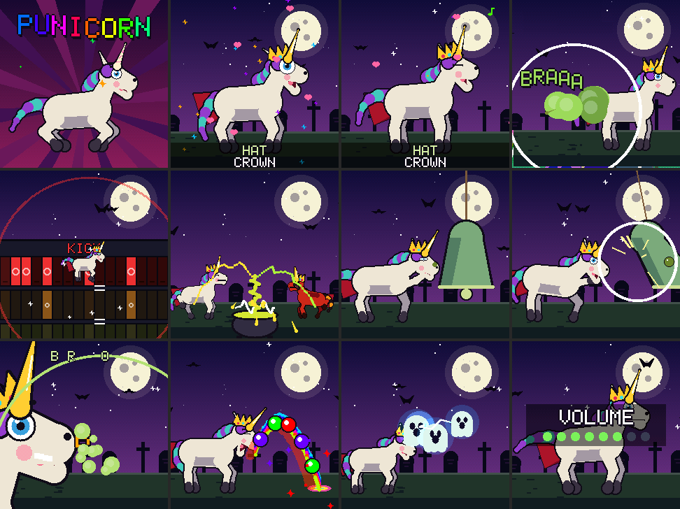

# Punicorn

A firmware for the **M-Vave FM-1** that turns it into a loud, rude, dark-fantasy music toy for a small child. A unicorn lives on
the screen. Every function button is a different scene with a different instrument, and every key and knob makes something
happen on screen: clouds, streams, sparks, ghosts and boogers. What you see follows what you hear. A fart cloud is as big and
as long as the bass note, and the pee streams wiggle with the waveforms you're hearing.



Built on [Felucca](https://github.com/hugelton/Felucca) by Leo Kuroshita (Hügelton Instruments) and its Rainbow mode fork
([felucca-rainbow](https://github.com/joshbartlettband-web/felucca-rainbow)). GPL-3.0.

## Install

1. Download `dist/punicorn.fwsc` from this repo, or `punicorn.fwsc` from the
   [latest release](../../releases/tag/latest).
2. Install it the way you'd install any FM-1 firmware: M-Vave's updater, the
   [Felucca web installer](https://hugelton.github.io/Felucca/webapp/installer/) (load a local file), or
   `python3 tools/fm1_install.py dist/punicorn.fwsc`.

Installing firmware is at your own risk. If an install fails and the FM-1 won't start,
[FM-1-transporter](https://github.com/kurogedelic/FM-1-transporter) can recover it.

## The scenes

| Button | Scene | Instrument | What happens |
| --- | --- | --- | --- |
| HOME | DRESS UP | a music box (PRESETS: harp, organ, chip, strings, flute) | The unicorn sings when you play, and notes fly off its horn. KNOB 1 to 4 set its **color, clothes, horn and hat**. SELECT changes the **world**, ALGORITHM the **weather**. The look is kept when it's switched off. |
| FX | FART BASS | an 808-style bass drum that can get rude | Every key is a kick. The tail goes up, the face strains, and a gas cloud comes out that's as loud and long as the sound. Low keys make big clouds and shake the screen. KNOB 1 length, 2 pitch drop, 3 FLAP (the raspberry, and it gets wet), 4 STINK (the gas turns purple and flies show up). SELECT tone, ALGORITHM flutter, PRESETS five ready-made farts. |
| SCL | BEAT STREET | a 16-step drum sequencer | A sidewalk of 16 tiles. The white keys are the tiles: tap one to put a drum on it. SELECT turns to the next road (kick, snare, clap, hat, open hat, tom, rim, bell), and each road has its own color. The unicorn hops from tile to tile and dances. Key lights show the road. KNOB 1 tempo, 2 swing, 3 kit, 4 tune, ALGORITHM decay, PRESETS ready-made beats. |
| ENV | PEE WAVES | an additive synth: two oscillators summed | Two unicorns pee into a cauldron. Each stream wiggles with its own waveform. KNOB 1 and 2 morph each one from sine to triangle, saw and square. Where the streams meet they add up, and the falling stream and the cauldron's surface show the sum. KNOB 3 puts the second one on a harmonic (half, same, fifth, x2 to x6), and the second unicorn shrinks to match. KNOB 4 mixes them. SELECT tone (the night closes in), ALGORITHM a slow swell. PRESETS: both, or one unicorn alone, close up. |
| LFO | BOOGER BELLS | physical modelling (struck resonators) | The unicorn digs in its nose, then flicks. The booger flies, hits, and the thing rings and wobbles. Boogers stick, drip, and fall off. PRESETS picks the target: a bell, ribs, a spider web, a cauldron drum or crystals, each a different modelled sound. KNOB 1 to 4 shape the resonator, SELECT the cave's echo, ALGORITHM how hard. |
| ARP | BURP BOX | a formant voice (vowels) | A close-up of the face. Each key is a burp that slides from one vowel to another. The jaw opens with the sound, letters fly out, and the gas follows. KNOB 1 and 2 the two vowels, 3 growl, 4 gas, SELECT size (pitch of the throat), ALGORITHM how fast it talks. PRESETS: monster, singer, angel, ghost. |
| EDIT | RAINBOW BARF | an arpeggiator | Hold keys and the unicorn barfs a rainbow. Every note the arpeggiator plays is a colored blob riding it into a puddle. KNOB 1 speed, 2 range (the arc gets taller), 3 order, 4 echo (a ghost rainbow behind). SELECT sound, ALGORITHM chunk size, PRESETS latch. |
| GLO | GHOST GLOW | a choir pad with slow envelopes | Each key calls a ghost up from the ground. The horn holds it with lightning while the key is held, then it drifts off. KNOB 1 rise, 2 linger, 3 wobble, 4 reverb. SELECT choir, pad, strings or organ. ALGORITHM chords (a key calls three ghosts). PRESETS brightness. |

## Everywhere

| Control | What it does |
| --- | --- |
| Keys | Play. Every key lands in C major pentatonic, so nothing sounds wrong. |
| PLAY | The BEAT STREET beat on or off, under any scene. |
| SEQ | The next ready-made beat (boom, rock, hip hop, disco, spooky, trap, march), playing. |
| REC | The next world, with a bang. |
| SAVE | A surprise: a random unicorn outfit. |
| OCT- / OCT+ | Low, middle, high. |
| Any knob | Its name and value pop up at the bottom. |
| MASTER | Volume, never above the grown-ups' maximum. |
| (nothing for 45 s) | The unicorn falls asleep. Any key wakes it up. |

**For grown-ups:**

- **HOME held 1 second, then OCT- / OCT+** sets the maximum volume (8 steps, kept when switched off). It starts at about half.
- **HOME + SAVE held 3 seconds** leaves Punicorn for the full Felucca synth. Switching off and on brings Punicorn back.
- **OCT- + OCT+ held 5 seconds** enters update mode, as on stock Felucca.

## Worlds

Graveyard, Slime Sewer, Spooky Woods, Candy Goth, Hellfire, Deep Space, Frost Crypt and Blood Castle. Each has its own sky, moon
or watcher, skyline and weather. Weather can be changed separately: stars, bats, embers, snow, bubbles, fireflies, hearts or rain.

## Building

GitHub builds it on every push to `main` (`.github/workflows/build.yml`). The workflow downloads the JieLi toolchain and three
files of the JieLi AC79 SDK, then runs `sh build.sh --release 1.0`. Every script is run through `sh` explicitly, so a checkout
without the executable bit still builds. The package goes to the `latest` release and to the `ci` branch, with the build log.

To build yourself, see [BUILDING.md](BUILDING.md) (`sh tools/get_toolchain.sh`, the SDK, then `sh build.sh`).

To look at the scenes without an FM-1, use the host simulator. It runs the same firmware code against a simulated FM-1 and writes
the screen as pictures and the sound as a WAV:

```
python3 tools/punisim.py out.png "w2000 bFX k2 w300 s K2 w500 s" 4
```

(`wN` wait, `bNAME` tap a button, `kN` / `KN` key down / up, `eK1:3` turn a knob, `s` take a picture.)

## How it works

- `firmware/src/puni.c`: the mode itself: input, the scene switcher, volume, the saved look, the LEDs.
- `firmware/src/puni_scenes.c`: the eight scenes: their sounds, knobs, animation and drawing.
- `firmware/src/puni_uni.c`: the unicorn: a rig of bones posed by springs, with leg IK, outfits and expressions.
- `firmware/src/puni_fx.c`: particles, pop-up words and the worlds.
- `firmware/src/puni_gfx.c`: drawing without a frame buffer. Each frame is drawn once to hash every 16 px tile; only tiles
  whose hash changed are drawn again and sent to the panel.
- `firmware/src/eng_puni.c`: the FART and PEE sound engine, in the engine slot Felucca's retired DIGITAL left empty.

The other sounds are Felucca's own engines (PHYS, VOICE, ANALOG, LOFI, TRIO, WHEEL, DRUM).
